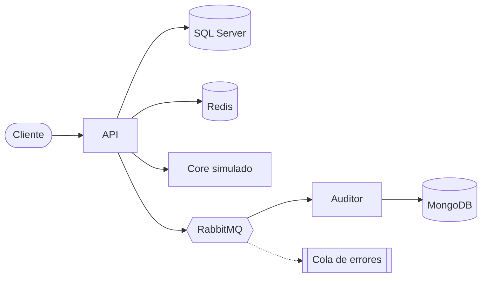
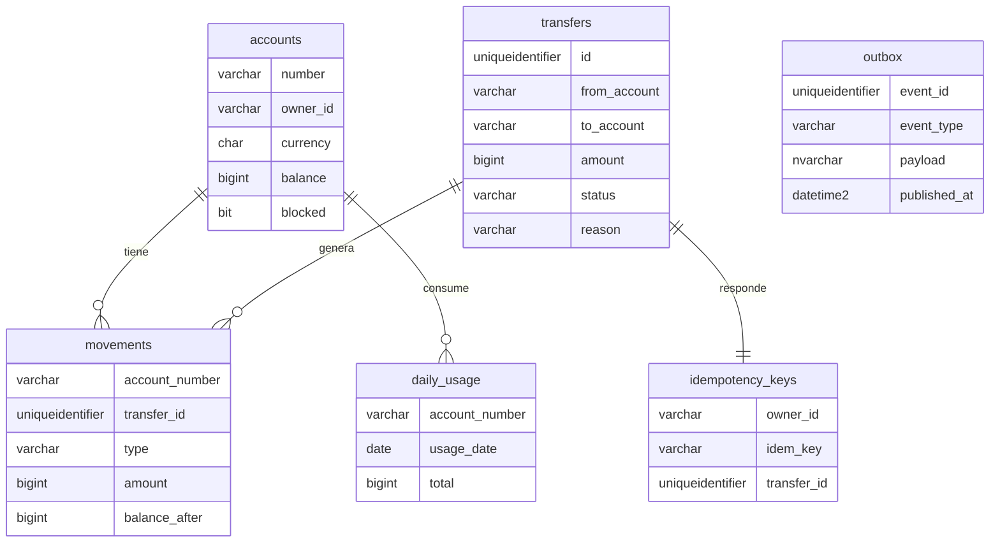

# PruebaPivote

Microservicio de transferencias en Go para la prueba técnica de Pivote Backend.

Permite abrir cuentas en quetzales o dólares, consultar el saldo, bloquear y desbloquear cuentas, hacer transferencias entre cuentas de la misma moneda y ver el estado de cuenta.

## Cómo ejecutarlo

Solo se necesita Docker:

```bash
docker compose up --build
```

La primera vez tarda un poco porque SQL Server se toma unos 30 segundos en arrancar. La API espera a que esté lista, crea la base de datos y corre las migraciones sola.

Estos son los servicios que se levantan:

| Servicio | Puerto |
|---|---|
| API | 8080 |
| Core simulado | 8090 |
| Auditor | no expone puerto |
| SQL Server | 1433, usuario sa y contraseña Pivote_2026! |
| MongoDB | 27017 |
| Redis | 6379 |
| RabbitMQ | 5672, y la consola en http://localhost:15672 con guest y guest |

### Tokens de prueba

El compose deja activo un endpoint que entrega tokens para cualquier usuario. Por ejemplo, para dos usuarios distintos:

```bash
curl -s -X POST localhost:8080/auth/token -d '{"user_id":"ana"}'
curl -s -X POST localhost:8080/auth/token -d '{"user_id":"beto"}'
```

El valor de access_token se manda en el header Authorization como Bearer. Cada usuario solo puede ver y usar sus propias cuentas.

### Ejemplos

En el archivo requests.http están todos los requests listos para usarse con la extensión REST Client de VS Code. La especificación OpenAPI está en api/openapi.yaml.

Un ejemplo rápido con curl:

```bash
TOKEN=$(curl -s -X POST localhost:8080/auth/token -d '{"user_id":"ana"}' | jq -r .access_token)

curl -s -X POST localhost:8080/accounts -H "Authorization: Bearer $TOKEN" \
  -d '{"currency":"GTQ","initial_balance":"20000.00"}'

curl -s -X POST localhost:8080/transfers -H "Authorization: Bearer $TOKEN" \
  -H "Idempotency-Key: pago-001" \
  -d '{"from_account":"<origen>","to_account":"<destino>","amount":"250.00"}'
```

### Apagar o encender la validación con el core

Se hace desde Redis, sin reiniciar nada:

```bash
docker compose exec redis redis-cli SET feature:core_validation off
docker compose exec redis redis-cli DEL feature:core_validation
```

El primer comando la apaga y el segundo la vuelve a encender.

### Pruebas

```bash
go test ./...
docker compose up -d sqlserver redis
go test -tags=integration -count=1 ./tests/...
```

Las pruebas unitarias no necesitan Docker. Las de integración prueban el flujo completo y la concurrencia contra SQL Server y Redis. El pipeline de CI corre go vet, golangci-lint y las dos clases de pruebas.

## Arquitectura



Son tres programas en el mismo repositorio: la API, el auditor y el core simulado. El código está ordenado en tres capas:

- internal/domain tiene las entidades, las reglas del negocio y las interfaces de los repositorios.
- internal/application tiene los casos de uso, con sus pruebas.
- internal/adapters tiene lo que habla con el exterior: HTTP, SQL Server, Redis, RabbitMQ, MongoDB y el cliente del core.

Los casos de uso solo conocen interfaces, por eso las pruebas unitarias usan mocks generados con mockery. Si cambia una interfaz, los mocks se regeneran con el comando mockery.

### Modelo de datos



## Para qué uso cada motor

SQL Server guarda todo lo que tiene que ver con dinero: cuentas, saldos, transferencias, movimientos y el límite diario. Lo elegí porque permite hacer todo dentro de una transacción, así que o se guarda todo o no se guarda nada.

Redis evita que dos solicitudes con la misma Idempotency-Key se procesen al mismo tiempo y guarda el interruptor para apagar la validación con el core. Si Redis se cae, la API sigue funcionando.

RabbitMQ publica los eventos transfer.completed y transfer.rejected para que otros servicios se enteren.

MongoDB guarda la auditoría de esos eventos.

## Decisiones principales

Los montos se guardan en centavos como números enteros y viajan como texto, por ejemplo "250.00", para no perder precisión con decimales.

Cada transferencia pasa en una sola transacción. Las dos cuentas se bloquean mientras dura, siempre en el mismo orden, para que dos solicitudes al mismo tiempo no dejen un saldo negativo. Además, la tabla no acepta saldos negativos.

La tabla de movimientos tiene un trigger que impide editarlos o borrarlos, así el historial no se puede modificar.

La Idempotency-Key se guarda junto con la transferencia. Si llega otra vez, se devuelve la misma respuesta, aunque sea días después. Si llega con otro monto, se rechaza.

El límite diario se lleva por cuenta y por día de Guatemala, dentro de la misma transacción. Solo cuentan las transferencias que se completaron.

Los eventos se guardan primero en una tabla (outbox) junto con la transferencia, y otro proceso los publica en RabbitMQ. Si RabbitMQ está caído, los eventos esperan y salen cuando vuelve.

El auditor usa el id del evento como llave en MongoDB, así un evento repetido no se guarda dos veces. Los mensajes que fallan se van a una cola de errores sin frenar a los demás.

El core solo se consulta para montos mayores a Q5,000 o USD 650, antes de abrir la transacción y con un máximo de 3.5 segundos. Si falla varias veces seguidas, se deja de llamar por unos segundos. Si no responde, la transferencia se rechaza, porque prefiero rechazar antes que mover dinero sin validar. El cliente nunca espera más de 5 segundos.

La prueba de concurrencia encontró bloqueos en la base porque el driver mandaba el texto como NVARCHAR y las columnas son VARCHAR. Lo corregí mandando el tipo correcto, y si aun así ocurre un bloqueo, la transacción se vuelve a intentar.

## Supuestos

- Las cuentas se pueden abrir con un saldo inicial, para poder probar sin depósitos.
- Se puede transferir a cuentas de otros usuarios; solo la cuenta de origen tiene que ser propia.
- Los rechazos por falta de saldo, cuenta bloqueada, límite o core responden con el código 422 y el motivo.
- El core simulado rechaza las cuentas destino que terminan en 99, para poder probar ese caso.

## Pendiente

- Limpiar las llaves de idempotencia y los eventos viejos.
- Reprocesar la cola de errores de auditoría, que hoy se hace a mano.
- Correr las migraciones como un paso aparte si hay varias réplicas.
- Exponer las métricas en formato Prometheus.

## Fuentes consultadas

- https://pkg.go.dev/net/http
- https://github.com/microsoft/go-mssqldb
- https://vektra.github.io/mockery/
- https://learn.microsoft.com/en-us/sql/t-sql/queries/hints-transact-sql-table
- https://www.rabbitmq.com/docs/confirms
- https://www.rabbitmq.com/docs/dlx
- https://microservices.io/patterns/data/transactional-outbox.html
- https://stripe.com/docs/api/idempotent_requests
- https://martinfowler.com/bliki/CircuitBreaker.html
